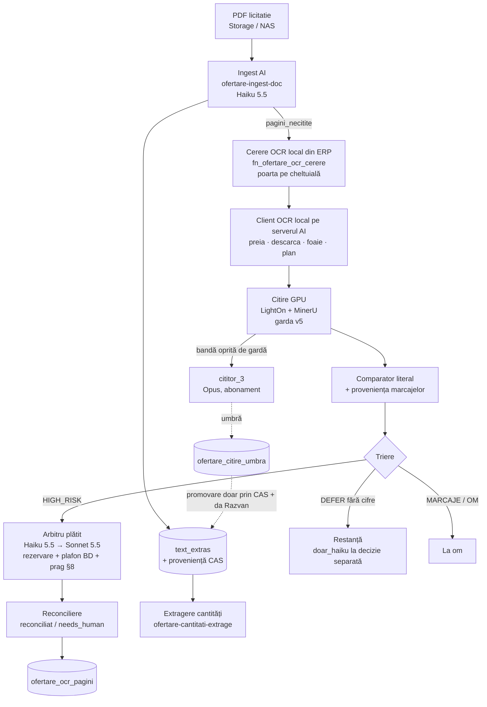

# Pipeline-ul de citire a documentelor (Ofertare) — de la PDF la BD

Document unic, cap-coadă (decizia Razvan 16.10.2026). **Orice PR care schimbă pipeline-ul îl actualizează în același PR** (secțiunea
afectată + un rând în „Istoric revizii”); CI-ul `pipeline-citire-doc.yml` pică altfel. Căile urmărite:
- **scripturi:** `scripts/ocr_local/**`, `scripts/recitire_val1/**`, `worker/ofertare/**`;
- **funcții edge:** `supabase/functions/ofertare-ocr-*`, `ofertare-ingest-doc`, `ofertare-cantitati-extrage`, `ofertare-citire-test`, `ofertare-pdf-link`, `ofertare-document-nou-citeste`, `ofertare-plansa-citeste`, `ofertare-word-text`, `ofertare-seap-import`, `ofertare-seap-veghe`;
- **cod comun:** `_shared/{transcriereTabel, provenientaText, gardaIngest*, cantNumar, cantNormalizare, cantComparator, cantAcoperire, dn}.ts`;
- **migrări / reveniri:** `*ofertare_ocr*`, `*ofertare_cant*`, `*ofertare_text_scrie*`, `*ofertare_citire_umbra*`, `*ofertare_ingest_garda*`, `*ofertare_buget*`.

Autori: partea 1 (ingest Haiku 5.5, proveniență / CAS, recitire, cantități — TKT-0329) = sesiunea Ofertare; partea 2 (OCR local,
arbitru, cititor_3, umbra) = laboratorul OCR; asamblarea = chatul principal.

## 0. Harta

---

## Partea 1 — Surse, ingest AI, proveniență, recitire, cantități (sesiunea Ofertare)

### 1.0 De unde vin documentele

Toate documentele ajung în `ofertare_documente_atribuire`: rândul documentului, plus fișierul în Storage, bucket `ofertare`, la `fisier_path`.

| Sursă | Cine o pornește | Ce scrie | Cost |
|---|---|---|---|
| **SEAP**: importul inițial al documentației | `ofertare-seap-import`, pornit din UI sau de veghe | rânduri de document + fișierele în Storage (`seap_cod`, `seap_meta`; `inlocuieste_id` la versiuni noi) | 0 (fără AI) |
| **SEAP**: documente apărute ulterior (clarificări, erate) | `ofertare-seap-veghe` (joburile cron `ofertare_seap_veghe_0520` / `_1250`, ora UTC), care cheamă importul prin HTTP | la fel | 0 |
| **Arhive** (zip / rar) desfăcute pe NAS | worker-ul NAS (`worker/ofertare/`) | părți `… — pNN_pagA-B.pdf` cu `pagina_offset` | 0 |
| **Manual** (încărcare în fișa licitației) | utilizator Ofertare, din UI | rând + fișier | 0 |

Rândul nou e `status_procesare = 'neprocesat'`. Citirea, adică scrierea în `text_extras`, e pasul următor (§1.1).

**Ce poate merge prost și cum se revine:**

| Situație | Revenire |
|---|---|
| Fișier de sistem (`__MACOSX`, `.DS_Store`) | ingest-ul îl marchează `ignorat`, fără cost |
| Non-PDF (docx, xls, dwg) | rămâne fișier; `.docx` se citește cu `ofertare-word-text` |
| Același fișier importat de două ori (copii între licitații) | Nu se deduplică. Recitirea valului 1 a citit separat copiile din lic. 103 (§1.3). |

### 1.1 Citirea în text (`ofertare-ingest-doc` și căile vecine)

**`ofertare-ingest-doc`**: drumul principal pentru PDF-uri, inclusiv scanate.

| Element | Valoare |
|---|---|
| Model, pe tipul documentului | Volumele (caiete, liste, `alta`): **`claude-haiku-5-5`** (din 15.10, commit `6f8a22c`; înainte Haiku 4.5), felii de **8** pagini. Documentele critice (`fisa_date`, `clarificare`, `raspuns_clarificare`, `formular`): **`claude-sonnet-5-5`** (din 17.10; înainte `claude-sonnet-5`, același preț), felii de **2**. Un parametru `model` poate forța alegerea. |
| Setări | `max_tokens` = `maxOut(model)` din `_shared/transcriereTabel.ts`: **12 000** pe Haiku 5.5, 8 000 în rest. Gândirea oprită pe model (`_shared/gandire.ts` → `faraGandire`): Haiku 5.5 `thinking: {type: 'disabled'}`, Sonnet 5.5 `{type: 'between_tools'}` (pe 5.5 `disabled` dă 400; `between_tools` = fără gândire extinsă, doar la effort ≤ high — nu trimitem effort, implicit high). Fără `temperature`. |
| Prompturi | `PROMPT_ANTET` pe prima felie: JSON cu obiectiv, beneficiar, proiectant, revizie, apoi `===TEXT===`. `PROMPT_TEXT` pe celelalte. Amândouă au **regula de tabel** (`REGULA_TABEL`: o linie pe rând, celulele separate prin ` \| `, inclusiv cele goale) și marcajele `⟦PAGINA N⟧`. |
| Numerotarea paginilor | Absolută: `pagina_offset` + pagina locală. `asiguraMarcaje` renumerotează secvențial când numărul marcajelor = numărul paginilor din felie. |
| Reluare | Cel mult 2 apeluri pe invocare. Progresul (`pagini_procesate`, `pagini_felie`) e salvat, iar invocarea următoare continuă de unde a rămas. |
| `max_tokens` atins | Felia se înjumătățește. O pagină singură care tot nu încape → pagină **necitită** (`pagini_necitite`). |
| Refuz (`stop_reason = refusal`) | Paginile feliei → necitite. |
| Felie peste 24 MB | Se înjumătățește. Pagina singură prea mare → necitită. |
| Text peste 900 000 de caractere | `taie_pagina.ts` taie la ultima pagină întreagă; paginile tăiate → necitite + avertisment. |
| Fișier peste 60 MB | Refuzat de edge. Îl citește worker-ul NAS (`citire_mare.ts`, pe felii). |
| Sărite | `procesat`; `partial` fără `reia: true`; `plansa` (are calea ei); documentele sparte în bucăți (se citesc bucățile); `ignorat`; documentele neeligibile pe loturi (poarta loturi 20261024b, înainte de orice descărcare sau AI) |
| Scrierea | **Garda de ingest** (20260930k): `ofertare_ingest_garda_incearca` (token, lease de 10 min, max 5 eșecuri, max 80 de descărcări), apoi `ofertare_ingest_garda_rezultat`. Acesta scrie rândul documentului (coloane din whitelist) în aceeași tranzacție cu verificarea tokenului, deci un token vechi e respins. Apoi proveniența (§1.2). |
| Cine o pornește | Un utilizator cu acces Ofertare care e **owner sau responsabilul licitației** (poarta pe cheltuială). Sau worker-ul NAS, cu `x-ingest-secret` = `OFERTARE_INGEST_SECRET`, pe coada `ofertare_ingest_coada` (butonul „☁ Pe server”). Cheia anon nu trece niciodată. |
| Cost | Haiku 5.5: 0,10 / 0,50 USD pe milion de tokeni (intrare / ieșire), sub pragul de 100k tokeni pe cerere; peste, 0,50 / 2,50. Sonnet 5.5: 2 / 10 (ca Sonnet 5). Fiecare apel ajunge în `ai_usage_log`. Laboratorul a măsurat ~0,005 USD pe 8 pagini cu Haiku 5.5. |

**Worker-ul NAS** (`worker/ofertare/ingest.ts`): consumă aceeași coadă.
- PDF-urile cu strat de text (≥ 85 % pagini cu text) se scot **gratuit**, cu `pdftotext`, cu aceleași marcaje.
- Antetul se citește cu Haiku 4.5 (~0,001 USD; încă Haiku 4.5 în worker).
- Scanurile trec prin edge-ul de mai sus.
- PDF-urile peste 60 MB se citesc local, pe felii.
- Scrie tot prin gardă. Nu scrie proveniență.

**Căile vecine** (scriu și ele `text_extras` sau date din citire):

| Funcție | Ce face | Model / cost | Cine o pornește | Proveniența |
|---|---|---|---|---|
| `ofertare-document-nou-citeste` | Rezumatul unui document apărut ulterior în SEAP → `analiza.citire_noi`. `text_extras` doar dacă era gol (CAS pe `analiza` și pe sha). | `claude-sonnet-5-5` (din 17.10), 2 / 10 USD pe milion (înainte logat greșit la 3 / 15); PDF-ul întreg doar pentru owner / responsabil / secretul intern | utilizator Ofertare, sau rutina cu `x-radar-secret` | `sinteza_ai` (nu e transcriere, deci nu e valid pentru cantități) |
| `ofertare-plansa-citeste` | Planșele A0, felie cu felie (tăiate de `/api/plansa-felii`): tabelele de dimensionare, cartușul, adnotările → `ofertare_cantitati` + `textPlansa` | `claude-opus-5`, cel mult `FELII_PE_RULARE` pe rulare | owner / responsabil | `sinteza_ai` |
| `ofertare-word-text` | `.doc` / `.docx` → text, fără AI | 0 | ca ingest-ul | — (scrie prin gardă) |

**Ce poate merge prost și cum se revine:**

| Situație | Efect | Revenire |
|---|---|---|
| Model care pierde cantități (Haiku 4.5, laborator 15.10: 44–63 % pe listele scanate) | text incomplet | **Recitirea** (§1.3) |
| Pagini necitite (refuz, prea mari) | `status_procesare = 'partial'` și `pagini_necitite` | `reia: true` după mărirea plafonului, sau OCR local (partea 2) |
| Rezultat întârziat de la o încercare veche | respins de gardă (tokenul) | automat |
| Worker oprit la mijloc (memorie) | lease expirat → încercarea se preia; după 5 eșecuri `blocat` | reactivare doar de owner (`ofertare_ingest_garda_reactiveaza`) |

### 1.2 Proveniența textului și CAS (20261031a, 20261031b)

**De ce există.** `text_extras` nu spune singur cum a fost produs. Pentru cantitățile structurate (§1.4) contează dacă textul e o **transcriere** sau o **sinteză AI**.

| Element | Ce este |
|---|---|
| `ofertare_doc_texte` | Arhiva content-addressed `(licitatie_id, sha256) → text`. Imuabilă, cu `CHECK` pe sha. Aici stau textele vechi după înlocuire. |
| `ofertare_doc_texte_prov` | Append-only, pe `(document, sha)`: `origine` (`transcriere` / `sinteza_ai`), `producator`, `completitudine` (`integral` / `partial`), `pagini_necitite`, `constatat_la` |
| `fn_ofertare_cb_text_scrie` (31a, refăcută în **31b**) | Funcția prin care producătorii scriu proveniența (`_shared/provenientaText.ts`, best-effort: o eroare nu oprește producătorul) |
| `fn_ofertare_cb_text_valid(_asof)` | Predicatul unic. Textul e **valid** pentru un document și un sha dacă ultima proveniență e `transcriere`, SAU dacă există o decizie umană `text_confirmat` nerevocată. Altfel `{}`. |
| Înghețarea (`fn_ofertare_cb_ingheata`) | Alege, pentru fiecare document, ultima proveniență ≤ moment. Un text fără dovadă intră în snapshot ca `text_indisponibil`. |

**Cum lucrează `fn_ofertare_cb_text_scrie` după 31b:**
- **Ordinea lock-urilor:** licitația `FOR KEY SHARE`, apoi documentul `FOR NO KEY UPDATE`. E aceeași ordine ca la pornirea extragerii de grup, deci fără ciclu de deadlock.
- **CAS:** proveniența se scrie DOAR dacă textul dat are exact sha-ul `text_extras`-ului curent. Altfel răspunsul e `{refuz: 'text_depasit'}` și nu se scrie nimic.
- **Efectul:** un producător întârziat nu poate scrie o proveniență „mai nouă” pentru un text deja înlocuit.

| | |
|---|---|
| Cine o pornește | Producătorii, ca service_role: ingest, `document-nou-citeste`, `plansa-citeste`. Worker-ul NAS și `word-text` NU scriu proveniență, deci textele lor nu sunt valide pentru cantități până la o confirmare umană. |
| Cost | 0 |
| Ce poate merge prost | Proveniența lipsă (texte mai vechi de 31a/31b, toate textele de dinainte de 16.10) → textul nu e valid pentru cantități. Se rezolvă cu `text_confirmat` (decizie umană, `fn_ofertare_cb_decizie`) sau cu o recitire. |
| Revenire | `supabase/revenire/20261031b_…_ROLLBACK.sql` (corpul din 31a) și `20261031a_…_ROLLBACK.sql`. Amândouă sunt armate pe tranzacție. 31a și 31b sunt APLICATE pe 16.10. |

### 1.3 Recitirea textelor și laboratorul de citire (`ofertare-citire-test`, `scripts/recitire_val1/`)

**Laboratorul (`ofertare-citire-test`)**
- Citește un document cu un model ales (`haiku` = 4.5, `haiku55`, `sonnet`, `opus`), pe felii, cu exact promptul și regula de tabel ale ingest-ului.
- Scrie DOAR în `ofertare_citire_test` (text, tokeni, cost, eroare pe felie) și în `ai_usage_log`. Nu atinge documentul.
- Pe el s-a făcut proba din 15.10: Haiku 5.5 față de Haiku 4.5 pe primele 8 pagini.
- **Atenție:** poarta lui e doar „acces Ofertare”, NU poarta pe cheltuială. Orice utilizator Ofertare poate porni apeluri plătite. De închis după valul 1: recitirea valului 1 îl folosește cu `claudetest@`, care e admin, nu owner.

**Recitirea, varianta C** (decizia lui Răzvan, 16.10)

- **Valul 1:** procedură unică (`docs/ofertare/RECITIRE_VAL1_PROCEDURA.md` v5, scripturile din `scripts/recitire_val1/`, #734). Cuprinde 20 de liste de cantități:
  - 13 citite cu Haiku 4.5;
  - 7 copii ale lic. 5 în lic. 103.

  Toate 20 au zero date derivate.
- **Valul 2 (celelalte ~950 de documente):** abia după protocolul general de versiune a textului (varianta A, `docs/ofertare/RECITIRE_TEXTE_SPEC.md` v3, doar intrare).

| Pas | Cine | Cost | Ce poate merge prost → revenire |
|---|---|---|---|
| 0. `pas0.sql`: cele 20 de documente au tot zero derivate și sunt `procesat` | chat, read-only | 0 | o abatere → oprire, decide Răzvan |
| 1. `fereastra.ts deschide`: snapshot-ul joburilor (o dată), cele 13 joburi Ofertare oprite, worker-ul NAS oprit, golirea `T_gol` + 15 min. Coada `pg_net` numără DOAR cererile spre `/functions/v1/ofertare-*` și `vercel-relay` (care pornește `seap-import` pe Vercel), pentru că joburile altor module țin coada globală mereu ocupată (#745). Orice activitate nouă reia așteptarea. | chat, seara, cu „da”-ul lui Răzvan | 0 | stare coruptă → oprire fără suprascriere. **La orice eroare după deschidere: `fereastra.ts inchide`** (repune exact joburile și worker-ul). |
| 2. `citeste.ts`: laboratorul, Haiku 5.5, secvențial, UN apel pe invocare | chat, cu „da” | plafon **dur 1,00 USD** pe val (rezervare persistentă de 0,53 USD înaintea fiecărui apel, cazul cel mai rău). Așteptat ~0,33 USD. | apel fără exact un rând de staging, usage neatribuit, apel străin, sursă schimbată → oprire, cu rezervarea păstrată. Registrul valului e unul singur (`rulare.json`) și ilizibil = oprire. |
| 3. `asambleaza.ts`: marcaje brute exacte (fără reparare), acoperire 1..pagini, identitatea citirii = cea din BD, convenția numerică pe grupul de părți (212 + 213) | chat, local | 0 | integritatea nu se poate excepta. Calitatea (`cantitati_m` nou ≥ vechi) se poate accepta nominal de Răzvan. |
| 4. Preview → „da”-ul lui Răzvan, cu commit-ul + sha256 al `manifest_aprobat.csv` | Răzvan | — | — |
| 5. `aplica.sql`: o tranzacție psql ca postgres | chat | 0 | Pași: `LOCK TABLE … IN SHARE MODE` pe tabelele derivate, apoi CAS pe text, identitate, metadate, PDF-ul din Storage și licitație, apoi arhivarea textului vechi și nou, apoi `UPDATE`, apoi proveniența `transcriere` / `recitire-haiku-5-5`. Orice abatere → `RAISE`, nimic scris. După COMMIT, `aplica_rezultat.sql` verifică egalitatea cu `RETURNING`. |
| 6. `verifica.sql`, după 24h | chat, read-only | 0 | derivat pe text depășit → eșec, decide Răzvan. Derivate fără versiune → „nedovedit”, listate. |
| R. `revino.sql` | chat, cu „da” | 0 | CAS pe starea exactă de după aplicare. Textul și metadatele vechi revin. Proveniența `sinteza_ai` / `revenire-recitire` face înghețarea să aleagă textul vechi, marcat `text_indisponibil`. |

**Conexiunea postgres a recitirii** (`RV1_PG_URL`, ca postgres; #744, după prima pornire din 16.10):
- **Problema:** deno-postgres v0.19.3 nu verifica certificatul pooler-ului și trecea tăcut pe necriptat.
- **Acum** conexiunea se face DOAR criptat și verificat: `verify-full`, adică lanțul de certificate și numele de gazdă, cu CA-ul Supabase din repo. Fișierul e `scripts/recitire_val1/supabase-prod-ca-2021.crt`: Supabase Root 2021 CA, public, sha256 `80:70:25:AD:…:CA:FA`, valid până la 26.04.2031.
- **`conexiune.ts`** e comun pentru tot ce se conectează:
  - URL-ul se citește cu parametrii decodați și e permis doar `sslmode=verify-full`;
  - erorile au mesaje fixe pe categorii (TLS / autentificare / rețea), fără parolă.
- **`fereastra.ts`** folosește `tls: { enabled, enforce, caCertificates }`. Orice eșec → cod 2, fără nicio schimbare.
- **psql se rulează DOAR prin `scripts/recitire_val1/psql.ts`:**
  - conexiunea se dă ca cuvinte-cheie libpq (`sslmode=verify-full sslrootcert=…`); parola doar în mediul procesului;
  - `-X` e impus și stdin e închis, deci nu poate intra un `\connect` pe stdin;
  - argumentele trec pe o listă albă structurală: `-X -1 -q -v NUME=…` și exact un `-f`, cu calea exactă a unuia din cele 6 scripturi ale procedurii;
  - erorile de conectare ale psql apar doar pe categorii;
  - executabilul se ia din `RV1_PSQL` (pe serverul AI: `C:/Users/Public/pgsql/bin/psql.exe`).
- **Verificat pe viu** (tenant inexistent):
  - CA-ul nostru: TLS trece;
  - CA greșit: `certificate verify failed`;
  - formele de ocolire (`-Xd…sslmode=disable`, `\connect` pe stdin, `-h`): refuzate.

**Worker-ul NAS** se oprește și pornește de pe serverul AI (pașii 1 și 8 din README): `terra_ssh.py '…/docker stop|start gazpet-ofertare-worker'`.

**Confirmarea costului** (#747, după fereastra_2 din 16.10):
- `ofertare_citire_test.cost_usd` e `numeric(10,4)`, iar `ai_usage_log.cost_usd` e `numeric(10,6)`.
- Pilotul recalculează costul din tokeni (tariful Haiku 5.5, pe treaptă) și îl compară cu fiecare rând, la precizia lui. Costul confirmat e cel exact.
- O oprire pe „cost neconfirmat” se rezolvă cu `citeste.ts <dir_val> --reconciliaza` (fără AI), nu editând registrul.

Testele: 56 Deno (`deno test -A scripts/recitire_val1/`) și harness-ul PG16 `scripts/test_recitire_val1.sh`.

### 1.4 Cantitățile structurate și comparatorul (TKT-0329 B: 20261031a, `ofertare-cantitati-extrage`, `_shared/cantComparator.ts`)

**Extragerea (modul `structurat`, PR3 #729)**

| Pas | Ce face |
|---|---|
| Intrarea | Doar documentele cu **text valid** (§1.2). Celelalte sunt sărite (`text_nevalid`). |
| Rolurile | Rolurile pe secțiuni (`f3`, `c6`, `atr`, `cs`, `fisa_date`, `memoriu`, `plansa`…), din antet, marcaje sau titlu. Deciziile omului (`rol_confirmat` / `nu_e_sursa_cantitativa`) le înlocuiesc. |
| Feliile | Felii cu poziție. Extractorul implicit **B** = `gpt-5-mini@p3@n4@f2` (cheia `OPENAI_API_KEY`) întoarce rânduri. |
| Extractorul A (opt-in, PR A1 #792) | Doar cu `extractor: 'A'` în corpul cererii structurate (altfel B, neschimbat): **Claude Haiku 5.5** (`claude-haiku-5-5`, cheia `ANTHROPIC_API_KEY`) cu **structured outputs** (`output_config.format` json_schema = exact câmpurile `CAMPURI_RAND`, fără enum pe material / Dn / SDR / UM / cantitate), gândirea oprită (`thinking: disabled` — la Haiku 5.5 tokenii de gândire se taxează ca ieșire), fără `temperature` / prefill. Prompt `p4` (un rând de articol care se termină cu „\| 0.000 \| 0 Total=” se extrage; doar linia cu DOAR „0.000 0 Total=” se omite). Identitate proprie `claude-haiku-5-5@p4@n4@f2` (cache / muncă separate de B). **Tarif pe trepte**: ≤ 100k tokeni intrare $0,10 / $0,50 per MTok, peste $0,50 / $2,50. **Rezervarea** = octeții promptului + `OVERHEAD_A` (octeții schemei + 4.000 pentru încadrarea cererii — intrare facturată care nu e în prompt), treapta aleasă pe această sumă (octeți ≥ tokeni, și cu tokenizatorul nou), plus ieșirea la `MAX_IESIRE`; decontarea pe tokenii reali. `stop_reason` ≠ `end_turn` (tăiat / refuz) = rezultat incert („necunoscut”, nu se scrie ca extragere completă); excepția de rețea se întoarce ca eroare. |
| Normalizarea în cod (`_shared/cantNumar.ts`, `cantNormalizare.ts`, `dn.ts`) | Cantitatea e **dovedită** doar dacă tokenul întreg e găsit în textul documentului, are UM-ul alăturat sau UM-ul din antetul coloanei, și nu e diametru sau exponent. **Dovada pe rând** (val 2, PR-A, normalizator `n3`): codul de articol dat de model trebuie să fie un identificator ÎNTREG al liniei cantității, iar Dn-urile din denumire + citat în blocul rândului. Blocul = linia cantității; liniile de dedesubt intră doar dacă lista e certificată pe DOCUMENT ca „denumirea dedesubt” (`orientareDedesubt`: primul articol nu e precedat de „Total=” și fiecare articol are „Total=” propriu înaintea următorului — 212: 507/507, 213: 320/320) și cu delimitare pozitivă: prima linie ne-goală de deasupra rândului (marcajele de pagină sunt transparente) e „Total=” al articolului precedent — antetul, începutul textului sau orice altceva = incert (denumirea poate fi deasupra) → doar linia; un „Total=” pe linia cantității = articol întreg pe linie, iar continuarea se închide în linia „… Total=” a articolului (fără alte litere), max. 4 linii, fără început de articol / linie care începe cu un cod / cantitate în formatul listei „120.000” / linie cu UM / linie goală / pagină nouă între ele). Un cod declarat într-un format nerecunoscut („SA11H1,”, „670 1153”) → `cod_neverificabil`; „fără cod” = gol / „-” / „null” / „n/a”; la tabelul markdown doar linia. Altfel `cod_alt_rand` / `dn_alt_rand` → nedovedit (riscul DN63/DN110). Un Dn în plus pe rând → `dn_ambiguu`. Listele cu denumirea DEASUPRA cantității rămân nedovedite (fail-closed). **Risc rezidual acceptat (decizia Răzvan, 16.10.2026, varianta A):** orientarea listei (denumirea sub sau deasupra articolului) NU se poate dovedi din text — un document construit anume (6 contraexemple sintetice Jakarinos, PR #749 r1–r6) poate trece certificarea; o certificare mai strictă respinge textele reale 212 / 213. De aceea un Dn dovedit DOAR din liniile de sub cantitate e o clasă separată: nota `dn_din_continuare` și `rand_interval` = tot blocul (trece de sfârșitul liniei cantității) — B2 / PR4b le arată separat, cu bifă umană înainte de H2 „gata”. **Soluția de fond (C)**, programată de luni 19.10: orientarea din geometria PDF-ului (`pdftotext -bbox` pe NAS). **Convenția numerică** (`3.995` = 3995 sau 3,995) se ia doar din dovezi tari, pe GRUPUL de părți ale aceluiași PDF. Un token ambiguu → `valoare_ambigua` → cheia `incomplet`. |
| Pornirea | Prin `fn_ofertare_cb_extragere_incepe_grup` (31b), sub mutexul licitației: documentele `FOR SHARE NOWAIT`, verificarea manifestului de grup, verificarea deciziilor de rol, apoi cererea. |
| Scrierea | Rezultatul intră în tabelele imuabile `ofertare_cant_extrageri` / `_felii` / `_obs`. |
| Rândurile nenormalizabile (după proba Răcari, 17.10, extractor `p2`, normalizatorul neschimbat `n3`) | Un rând al modelului care nu se poate normaliza pierde felia („esuat”, reluare doar umană cu `fn_ofertare_cb_felie_reia`), oricare ar fi UM-ul declarat — „UM ≠ m” nu dovedește irelevanța (review Jakarinos #754 r1). Raportul HTTP poartă `mostre` (primele 3 rânduri pierdute / începutul unui răspuns neinterpretabil, trunchiate) — conținut extern, doar pentru diagnoză. Promptul `p2`: citat verbatim, continuu, fără „...”; 16 elemente pe rând; fără totaluri valorice; în C6 doar rândurile în m / ml / km. **Limite cunoscute** (#754 r1–r3, de rezolvat cu geometria PDF — C): (1) ultima celulă de tabel fără „|” de închidere („| M.C. | 0.19”, listele C6) rămâne nedovedită — rolul coloanei (cantitate vs. preț) nu se poate dovedi din text (#754 r1–r2: aliniere după „|” inițial, antete pe mai multe linii, „cost pe unitate de cantitate”); (2) UM-ul vecin poate fi căutat peste capătul liniei (comportament existent; restrângerea lui slăbea oprirea continuării din `blocRand` și transforma `token_multiplu` în dovadă — #754 r3). Orice schimbare a promptului / normalizatorului schimbă `extractor_id` → extragere nouă (cache-ul vechi nu se refolosește). |
| Extractorul `p3` / `n4` (după re-extragerea p2, 17.10) | p2 a reparat CS (318: 13 / 16 rânduri Dn 90 dovedite) dar a stricat F3 (0 dovedite: citate minuscule și reordonate, „130.000 M”, „0.000 0 Total=”). `p3`: citatul unei liste = linia rândului de la nr. / cod până după cantitate, verbatim; în text = propoziția întreagă; peste 300 de caractere = ultimele caractere continue până după cantitate și UM; exemplu de rând de 16 elemente cu codul și denumirea separate; doar rândurile cu cantitate. `n4`: rândul-OBIECT cu cheile exact din `CAMPURI_RAND` e acceptat (modelul l-a întors pe C7); tabloul cu ≠ 16 elemente e respins (înainte: < 16). Secțiunile `lista_alt` RĂMÂN extrase (review #757 r1: eticheta e euristică — o pagină F3 sau un memoriu o pot moșteni — deci excluderea ar tăia lungimi reale). |

**Comparatorul (`_shared/cantComparator.ts`, PR4a #731; funcții pure, încă nelegat de UI)**
- **Deduplicarea:** pe valori brute, doar la același (document, sha, offset) cu semantică identică. Orice dezacord → `conflict_sursa`.
- **Agregarea:** `masura = lungime` (km → m), pe rol și cheie (`lot|obiect|tip|material|dn|um`), cu aliasuri umane.
- **Totalurile:** `suma_vs_total` și `suma_vs_subtotal`, emise mereu.
- **Pragurile:**
  - H2: diferență relativă > 0,1 %;
  - „de semnalat”: > 1 m ȘI > 1 %.
- **Acoperirea pe perechi:** `gata` doar cu toate condițiile îndeplinite. Neasociatele, cheile incomplete și anomaliile din roluri o blochează.
- **H2:** tri-state, `necalculat` / `incomplet` / `gata`.
- **Amprenta:** canonică.
- **PR4b**, după proba pe lic. 15: edge-ul „Recalculează”, tab-ul Comparație, view-ul H2.

**Completitudinea (val 2, PR-B1: `_shared/cantAcoperire.ts`, funcții pure, încă nelegate de comparator) — inventarul independent de rânduri, poarta de completitudine a extractorului A (plan aprobat de Răzvan 17.10)**
- **Inventarul (`inventarRanduri`, r3 după review Jakarinos #751 r2):** orice rând NUMEROTAT dintr-un tabel (≥ 2 „|”, ierarhic „5.1” cu identificatorul complet în `nr_id`) intră în inventar; rândul de tabel fără nr. dar cu cod (C6 nenumerotat) intră cu nr. null. Un rând de LISTĂ numerotat intră și fără cod / cantitate recunoscută, ca **incert** (`lista_fara_cod_sau_cantitate`) — NICIUN rând numerotat nu se elimină (r4): linia ambiguă (în interiorul unui tabel cu „|”, nr. care nu continuă secvența listei, nr. fără zerouri după rânduri „003”) rămâne în inventar ca incert `posibila_continuare`, dar NU intră în secvența nr. crt. (nu acoperă un gol, nu desparte tabele); în schimb tabelul în care apare (sau care urmează) primește `secventa_nedeterminata = true` + `nr_incerte` — golurile lui NU sunt dovedite și B2 trebuie să-l trateze ca „incomplet” (r5). Stare: **ancoră** (cantitate + UM recunoscute) sau **incert** (UM în afara listei, separator de mii prin spațiu — și când tokenizarea „găsește” o cantitate —, cantitate nelocalizată). Cantitatea de pe linia următoare se ia doar dacă aceea nu e începutul altui articol (numerotat sau rând de tabel cu cod). Codul se ia după POZIȚIE; „total” în denumirea unui articol numerotat nu-l scoate; subtotalurile nenumerotate nu sunt rânduri. Offseturile sunt în textul original.
- **Tabelele și golurile:** un tabel nou începe la reluarea de la 1 după un nr. > 1 sau la o scădere la ≤ 2 după un nr. > 2 (poziția 1 poate fi ea însăși incertă); orice altă scădere = reluare atipică (semnal pentru B2); schimbarea de format nu separă tabelul; nr. care scade fără să fie 1 = reluare atipică în același tabel; golurile = numerele dintre min și max care nu apar deloc, plus golurile ierarhice pe toate nivelurile („5.1, 5.3” sau „5.1.1, 5.3.1” → `5.2`). `sectiuni.ts` ȘI `roluri.ts` recunosc la fel titlurile „Lista consumurilor …” (C6 / C7 / C8 / C9) și „Centralizatorul cheltuielilor …” (F1 / F2 fără „Formular”, tabel de valori) — titlurile noi DOAR la început de linie (și „[Tabel rotit – …”), ca o mențiune în text să nu reclasifice pagina (r5).
- **Măsurătoarea pe textele valului 1** (`scripts/recitire_val1/masoara_ancore.ts`, doar secțiunile F3 / C6): 212 — 695 rânduri, 685 ancore, 10 incerte, 1 gol real (18–19); 213 — 526 / 526, 0 goluri; 171 — 776 / 776, 6 tabele cu golul 18–19; 165 — 77 / 76, 0 goluri. Secțiunile `lista_alt` (F1 / F2 / C7 / C8 / C9) au numerotare de referință și nu intră în poartă; `sectiuni.ts` recunoaște acum și „Lista consumurilor de resurse materiale / cu mana de lucru / de ore de functionare / privind transporturile” (feliere `f2`).
- **Poarta pe felie în extracție (PR A2 #793, `ofertare-cantitati-extrage/poartaB1.ts`):** pe feliile `f3` / `c6`, inventarul B1 față de observațiile DOVEDITE ale modelului. **Cerute** (lipsa = `deficit`): ancorele și incertele cu cantitate prezentă dar nerecunoscută (`separator_mii_spatiu`, `um_sau_cantitate_nerecunoscute`) — acoperite DOAR de o observație dovedită al cărei `cantitate_offset` e EXACT offsetul tokenului de cantitate expus de B1 (`RandInventar.cantitate_offset`: pe linia rândului, pe linia următoare împrumutată sau începutul numărului cu spații); nici altă apariție a aceleiași valori, nici altă cantitate din bloc nu acoperă; fără offset localizat = deficit; la C6 doar rândurile de lungime (m / km), ca promptul. **Semnalate** (fără deficit): celelalte incerte și tabelele B1 cu goluri / reluări / secvență nedeterminată → `complet = false` (B2 tratează felia ca incompletă). Rezultatul intră în raportul feliei (`poarta_b1`) și în corp (`felii_cu_deficit_b1`); pentru ambii extractori.
- **Escaladarea (PR A3 #794, doar extractorul A):** pe semnale deterministe — rezultat Haiku incert, rânduri nenormalizabile, `deficit` B1 — CEL MULT o dată pe felie la **Claude Sonnet 5.5** (`thinking: between_tools` — `disabled` dă 400 pe Sonnet 5.5 —, effort `medium`, aceeași schemă). Eroarea de rețea / HTTP nu escaladează (calea „necunoscut”). Identitatea extractorului A: `claude-haiku-5-5/claude-sonnet-5-5@p4@n4@f2` (separator `/` — `>` era respins de CHECK-ul `extractor_id`, fix 20.10; `idExtractor_test.ts` verifică orice id construit contra regex-ului din migrare). Sonnet e adoptat doar dacă Haiku nu era valid sau dacă Sonnet n-are rânduri nenormalizabile ȘI acoperă cel puțin la fel de multe rânduri cerute (altfel rămâne Haiku; `adoptat:haiku` / `adoptat:sonnet` în raport). **Plafonul înaintea oricărui apel, fără RPC nou:** rezervarea extractorului A acoperă de la început limita superioară a AMBELOR apeluri (Haiku + Sonnet pe același prompt + overhead); o singură decontare, cu costul real al ambelor și modelul `claude-haiku-5-5+claude-sonnet-5-5`. Identitatea: `claude-haiku-5-5/claude-sonnet-5-5@p4@n4@f2`. Corpul raportează `felii_escaladate` (pragul de GO al probei: ≤ 15%).
- **B2** (următorul): rândurile extrase comparate cu ancorele; golul sau acoperirea sub prag → tabelul „incomplet”. Limită cunoscută: listele de utilaje în ore fără coloană UM (ex. 167) nu au ancore.

| | |
|---|---|
| Cine o pornește | **Owner sau responsabilul licitației** (poarta pe cheltuială în edge, `poarta.ts`) și DOAR pe o **cerere** activă (`fn_ofertare_cb_cerere`: owner / responsabil / admin Ofertare). Cererea cere un **plafon** (`fn_ofertare_cb_buget_seteaza`, scopul `cant_extragere`): owner ≤ 100 USD sau admin Ofertare ≤ 5,00 USD (20261031d; adminul nu atinge un plafon > 5 existent), cu rolul în `ofertare_ai_buget_jurnal.rol`. **Admin Ofertare** (17.10.2026, decizia Răzvan „B”, `poarta_admin.ts`): pornește și el modul structurat, dar DOAR dacă simultan (1) `cerere_id` din corp e o cerere `activa`, nexpirată, a acestei licitații, pe `cant_extragere`; (2) plafonul curent din `ofertare_ai_buget` pe (licitație, `cant_extragere`) e ≤ 5,00 USD — un plafon > 5 e pus de owner, deci adminul e refuzat; (3) bugetul nu e `blocat`. Adminul = aceeași interogare ca `fn_ofertare_cb_este_admin` (`user_module_access` module = `ofertare`, access_level = `admin`), făcută în edge cu clientul service_role, ca `profiles` (funcția SQL nu e apelabilă din API). Cererea și bugetul se citesc cu clientul **utilizatorului** (JWT-ul apelantului): 20261031a revocă service_role pe ele, iar SELECT-ul pentru authenticated are policy `fn_are_acces_ofertare()`, pe care un admin Ofertare o îndeplinește. Limita de 5 USD se verifică doar la pornire: dacă owner-ul ridică plafonul între timp, rularea continuă sub plafonul pus de owner (`fn_ofertare_cb_rezerva` nu cunoaște limita adminului). Un editor Ofertare sau un admin pe alt modul primește refuzul vechi, fără citiri în cereri / buget. Orice citire eșuată = refuz (403, cu `motiv`: `cerere` / `buget_lipsa` / `plafon_peste_admin` / `buget_blocat`). Owner și responsabil: neschimbat. `x-radar-secret` e refuzat în acest mod. |
| Cost | Fiecare felie e plătită printr-o rezervare atomică în BD (`fn_ofertare_cb_rezerva`, apoi `fn_ofertare_cb_deconteaza` / `_necunoscuta` / `_abandon`). Consumul = decontat + deschis + necunoscut + abandonat. Depășirea rezervării → bugetul `blocat` (deblocare doar de owner). |
| Ce poate merge prost | Text nevalid → documentul e sărit. Grup schimbat sau ocupat → `grup_schimbat` / `grup_ocupat`, se reia. Felie cu rezultat necunoscut → socotită în consum, reluată doar de om (`fn_ofertare_cb_extragere_redeschide`). Cantități ambigue → `incomplet`, nu se adună. |
| Revenire | Tabelele sunt imuabile: o extragere nouă (alt sha / extractor) nu șterge istoricul. Migrarea are `supabase/revenire/20261031a_ofertare_cantitati_b_ROLLBACK.sql`, armată. |
| Starea la 16.10 | 31a + 31b + edge-urile deployate. **Proba plătită pe lic. 15 (Răcari) e amânată până după recitirea 212 / 213.** Plafonul și pornirea le face Răzvan; cererea o poate face `claudetest@`. După recitire, 212 / 213 au proveniență `transcriere`, deci nu mai cer `text_confirmat`. |
| **Concluzia probei Răcari (lic. 15, 17.10.2026, oprită la 1,01 din 2 USD)** | **Dn 90 pe F3 (articolul de montaj SA11G1): 6.400 m** (toate cele 16 rânduri găsite în rulări) **față de CS 3.995 m declarat / 3.875–4.018 m pe străzi (318) → ~+2.400 m (+60 %)** — semnal robust pe p1 / p2 / p3, **de verificat de un om pe PDF**. Iterațiile: **p1** — F3 dovedit 5.380 m (12 / 16 rânduri; DE4198 și AML8 cu cantitate null, TIN108 fără Dn), CS 1 / 26 dovedit (citate prescurtate cu „...”), 8 felii C6 eșuate aleator; **p2** (#754, citat verbatim) — CS 13 / 16 Dn 90 dovedite (3.317 m), F3 **0** dovedite (citate minuscule, reordonate: „130.000 M”, „0.000 0 Total=”); **p3** (#757, citatul = linia rândului) — F3 dovedit 5.200 m (212: 9 / 9 = 4.070, 213: 4 / 5 = 1.130 + 290 nedovediți), CS 14 / 16 = 3.551 m; 213 cu mai multe felii eșuate: modelul întoarce sistematic tablouri de 17 elemente pe C6 (respinse corect, n4), rânduri BUC. în C6, rânduri C7 fără denumire. Concluzie: gpt-5-mini nu respectă constant forma pozițională → **extractorul A** (plan aprobat de Răzvan 17.10: Claude Haiku 5.5 cu structured outputs, escaladare deterministă la Sonnet 5.5, inventarul independent B1 ca poartă de completitudine, probă comparativă A / B / D ≤ 0,90 USD) și **C** (geometria PDF, din 19.10) pentru orientare / celule. |

### 1.5 Porțile și plafoanele (rezumat)

| Pas plătit | Cine îl poate porni | Plafon / control |
|---|---|---|
| Ingest (`ofertare-ingest-doc`) | owner sau responsabilul licitației, sau worker-ul NAS (secret) | per apel în `ai_usage_log`, fără plafon pe licitație |
| `document-nou-citeste` (PDF întreg) | owner / responsabil / secretul intern. Rezumatul din textul existent: oricine are acces Ofertare. | per apel |
| `plansa-citeste` | owner / responsabil | `FELII_PE_RULARE` pe rulare |
| Laboratorul (`ofertare-citire-test`) | **orice utilizator Ofertare (gaură, de închis după valul 1)** | — |
| Recitirea valului 1 | chat, cu „da”-ul lui Răzvan, prin laborator | 1,00 USD dur pe val, rezervare 0,53 pe apel |
| Extragerea cantităților | owner / responsabil, pe cererea activă; **admin Ofertare** doar pe cererea activă exactă (`cerere_id`), cu plafonul curent ≤ 5 USD și bugetul neblocat (17.10) | plafonul `cant_extragere` (owner ≤ 100 / admin Ofertare ≤ 5; deblocarea doar owner), rezervare atomică |
| Arbitrul OCR (partea 2) | client, cu „da” pe sumă | plafonul rulării în BD |

---

## Partea 2 — OCR local (laboratorul OCR)

Cod: `scripts/ocr_local/` (client pe serverul AI), edge-urile `ofertare-ocr-scrie`, `ofertare-ocr-arbitreaza`, `ofertare-pdf-link`,
migrările 20261029b / c / e, 20261030d, 20261031c. Detaliile de proiectare:
`scripts/ocr_local/README.md`, `docs/ocrlab/*.md`.

### 2.1 Cine pornește ce
| Pas | Cine | Unde | Cost |
|---|---|---|---|
| Cererea rulării (`fn_ofertare_ocr_cerere`: licitație, documente cu `pagini_necitite`, plafon ≤ 15 USD) | om din ERP (poarta pe cheltuială) | BD | — |
| `erp preia / descarca / foaie / plan` | client, server AI | CPU, Storage (egress plafonat) | 0 |
| Confirmarea orientării paginilor | **om** (foaia de contact) | — | — |
| Pornirea vLLM (LightOn, apoi MinerU, un singur proces pe GPU, `gpu.lock`) | om / laborator, noaptea | GPU | 0 |
| `erp citeste`, `incarca-citiri`, `compara` | client | GPU / CPU / BD | 0 |
| `erp arbitreaza` | client, cu „da” Razvan pe sumă | edge + Anthropic API | plătit, plafonat în BD |
| Reluarea unei rulări oprite pe prag (`fn_ofertare_ocr_reia`, max 3) | chat, prin psql, cu „da” Razvan | BD | — |
| `erp reconciliaza` | client | CPU / BD | 0 |

### 2.2 Planul paginilor (`plan.py`)
Randare 150 dpi, orientarea **confirmată** (fără confirmare: `orientare_nerezolvata`, exclusă), deskew, benzi (text continuu → benzi
tăiate pe rânduri albe; tabel → pagina întreagă). **Rutarea v2 (#735)**: clasificarea pe pixeli (`drawing` / `grid_form` / `unknown`) NU
mai exclude pagina — e semnal `clasificare_incerta`, pagina se citește ca `quantity_table`; exclusă doar pagina practic albă
(cerneală < 0,2 %, fără `kind` dat de om). Motiv: pe Răcari, 140/176 de pagini din lista de cantități erau excluse ca „planșe”.

### 2.3 Cititorii și garda
LightOn-OCR-2 1B și MinerU 2.5 Pro 1.2B în vLLM pe loopback (`protocol.json`: căi, SHA-ul greutăților, comenzile `vllm serve`).
**Garda v5** (`guard.py`): oprește DOAR banda la buclă (bloc de 200 de caractere ×4, linie lungă ×4, celule goale, caractere unice puține),
după confirmarea vLLM liber; banda devine `banda_intreaga` → om. Scutirea imaginilor base64 MinerU e pe **proveniență înregistrată**
(#717), nu pe forma textului.

### 2.4 Comparatorul (`compare.py`)
Literal (varianta A, #718): cuvinte cu ș/ş, ț/ţ unificate DOAR la comparare; cifrele literal (separatorul zecimal nu se normalizează);
tabele rând cu rând; regula A (celule goale de la coada rândului). Ieșirea: dezacorduri `text`, `rand_tabel`, `rand_lipsa_*`,
`structura_tabele`, `banda_intreaga`, cu amprentă (`item_sha256`) legată de BD.
**Proveniența marcajelor (#737)**: marcajele scrise de pipeline (⟦rowspan⟧, cadrul ⟦img⟧ + `src`, ⟦tabel_neparsat⟧, ⟦…_invalid⟧, cadrul
⟦barat⟧, ^{ }/_{ }) trec prin `_m()`; în modul normal nimic nu se schimbă (segmente, itemi, BD); `segmente_provenienta` dă măștile, cu
paritate verificată (fail-closed).

### 2.5 Trierea (`triere.py`, #737 / #738)
| Clasă | Regula | Ce se întâmplă |
|---|---|---|
| HIGH_RISK | conținut diferit lângă cifre (număr, UM, semn, cod, coloană), proveniență nestabilită; **sau** diferența fără cifre atinge un termen de material / tehnologie (`TERMENI_MATERIAL`: PEHD/PVC, OL/OȚEL, FONTĂ, BETON, FORAJ/ȘANȚ, MANUAL/MECANIZAT, SUDURĂ, MONTAJ …, cu flexiuni prin rădăcini; „PE” simplu exclus; la rânduri pe perechi de celule (rând cu număr diferit de celule și termen de material = HIGH_RISK); plus calificativ „cu/fără/nu” sau valoare SDR citită ca litere lângă un termen) | arbitrul plătit (cascadă) |
| DEFER | conținut diferit, nicio cifră (Unicode) la niciun cititor | **restanță** (nu în masă la om) — a doua trecere decisă separat |
| MARCAJE | conținutul identic, diferă doar marcajele pipeline-ului | om |
| OM | `structura_tabele`, `banda_intreaga` | om, fără AI |
`erp arbitreaza --triere` e permis doar în probă (`--max-apeluri`) până la decizia pentru DEFER.

### 2.6 Arbitrul (`ofertare-ocr-arbitreaza`)
- **Cascadă** (implicit): Haiku 5.5 pe orice dezacord; Sonnet 5.5 (din 17.10; înainte Sonnet 5) când Haiku e nesigur sau citirile diferă în cifre.
  Gândirea oprită pe model în același corp de cerere: Haiku `disabled`, Sonnet 5.5 `between_tools` (`_shared/gandire.ts`). Același preț
  (2 / 10) și același tokenizer → aceeași limită de sus a rezervării. `protocol.json` → `modele_admise` = `claude-sonnet-5` (istoric,
  deciziile deja plătite rămân valabile), `claude-sonnet-5-5`, `claude-haiku-5-5`. Prompt versionat
  (`arb-v3`, #742: regula 10 diacritice); `protocol.json` → `prompt_versiuni_admise` (deciziile plătite pe versiuni vechi rămân valabile).
- **Poarta de diacritice** (#742, determinist, după decizia finală — Haiku sau Sonnet): dacă cele două citiri diferă doar prin semne
  combinante (detectare LARGĂ: NFD fără `\p{M}`), un `text_propus` e acceptat doar dacă are aceeași bază ca UNA dintre citiri, cu lista
  ÎNCHISĂ de semne scoase (U+0302 U+0306 U+030C U+0326 U+0327, doar după A-Z / a-z); altfel `needs_human`, text gol, cost real
  păstrat. Prinde ≠ / ≰ și semnele invizibile. Dezacordurile mixte (litere + diacritice) nu intră sub poartă.
- **doar_haiku** (#739): un apel Haiku, fără escaladare, refuz server-side dacă citirile din BD au vreo cifră (`\p{N}`); deciziile nu intră
  în pragul §8 (proveniență legată de tentativă + model + eticheta serverului).
- **Bani**: rezervare ATOMICĂ în BD pe limita de sus a apelului (`fn_ofertare_ocr_arbitraj_rezerva`), plafonul rulării
  (`cost + rezervat + abandonat ≤ plafon_usd`) = **poarta tare**; un plafon local în client e doar estimare (#736 respins).
- **Pragul §8**: needs_human > 15 % din arbitrajele Claude (după minim 20) → rularea `oprita`. Reluarea doar prin
  `fn_ofertare_ocr_reia` (max 3 pe rulare), numărătoarea pe epoca reluării.
- Validările 4xx ale edge-ului (400 / 413 / 422, înaintea rezervării, nimic cheltuit) nu opresc proba: item-ul e notat refuzat
  (`validare_<status>`) și sărit; un context > 2000 de caractere e sărit de client înainte de apel (#741).

### 2.7 Reconcilierea (`reconcile.py`)
Baza = LightOn; deciziile validate strict (schemă, model și versiune admise); dezacord fără decizie validă = needs_human; o pagină cu
needs_human nu are text propus. Semnalele (`clasificare_incerta`, cusături) ajung în `garda.semnale`.

### 2.8 Cititorul 3 și umbra
- **cititor_3** (`cititor3.py`, branch `ocrlab/cititor3`): a treia citire cu Claude Code headless pe serverul AI (`claude -p --restricted
  --tools Read --strict-mcp-config`, fără cheie API = abonament), un apel concurent, timeout per bandă, oprire la limita abonamentului
  (fără trecere pe API). Backend-ul din configurare: `claude_cli` acum, `api` mai târziu (pe traseul arbitrului, cu rezervare).
- **Umbra** (20261031c): `ofertare_citire_umbra`, lângă producție, legată de document / pagină / bandă / imagine / PDF (sha) / orientare,
  cu sha-ul `text_extras` la citire; scriere doar postgres (psql); un rând nou intră `neevaluat`; `promovat` doar din `bun`, doar în
  tranzacția armată de fluxul CAS (cu „da” Razvan); rândurile promovate nu se modifică / șterg.
- Rezultat Răcari (16.10): pe d205 p58 (listă de cantități, oprită la ambii cititori) Opus a recuperat ultimele 2 articole, verificate pe
  imagine.

### 2.9 Tabelele OCR
`ofertare_ocr_rulari` (stare, plafon, cost, rezervări), `ofertare_ocr_pagini` (citiri pe bandă + reconciliat pe pagină),
`ofertare_ocr_dezacorduri`, `ofertare_ocr_arbitraje`, `ofertare_ocr_reluari`, `ofertare_citire_umbra`. Citire: accesul Ofertare
(`fn_are_acces_ofertare`); scriere: doar prin RPC / edge cu secretul OCR local sau ca postgres (umbra, reluarea).

### 2.10 Costuri (măsurate)
| | Valoare | Sursă |
|---|---|---|
| Cascadă, per apel | ~0,0048 USD (escaladare ~50 %) | proba r1, 117 + 126 apeluri |
| Haiku singur (doar_haiku), per apel | ~0,0005 USD | proba r1, 179 de apeluri |
| r1 (102), arbitraj complet / doar HIGH_RISK (5.926) | ~57 / ~28 USD | `paw-data/ocrlab/masurare_triere.json` |
| GPU, Răcari 960 de benzi | LightOn 36 min, MinerU 38 min | noaptea 15→16.10 |
| cititor_3 (Opus, abonament) | 11–32 s / bandă (mediana 19 s) | 42 de benzi Răcari |
| Prețuri folosite la rezervare / decontare | Haiku 5.5 0,10 / 0,50 (peste 100k: 0,50 / 2,50); Sonnet 5.5 = Sonnet 5 = 2 / 10 USD pe milion | `_shared/ocrLocal.ts` → `PRETURI` (17.10: Sonnet 5.5 adăugat) |

### 2.11 Ce poate merge prost și cum se revine
| Situație | Efect | Revenire |
|---|---|---|
| Buclă la un cititor | banda oprită (`banda_intreaga`) | om / cititor_3 |
| Orientare greșită | citire greșită pe pagină | se confirmă pe imaginea ROTITĂ, nu pe miniatură |
| Prag §8 depășit | rularea `oprita` | `fn_ofertare_ocr_reia` (max 3), cu „da” |
| Plafon atins | rezervarea refuzată | plafon nou doar cu „da” |
| Apel cu rezultat necunoscut | item → needs_human, socotit la prag | automat la reluare |
| Migrare | — | `supabase/revenire/*_ROLLBACK.sql`, armată pe tranzacție |

### 2.12 Banca fără om (`banca.py`, unealtă de laborator — nu scrie în BD, nu cheltuie)
Măsoară cititorii și arbitrul pe zone etichetate pe imagine. Zona = textul dintre două ancore unice agreate de ambii cititori;
eșantion înghețat (`esantion.json`, hash); `pregateste` copiază imaginea (sha verificat) + ținta; harta zonă ↔ lot stă în `priv/`
(etichetatorul nu vede id-urile). Etichetare: **A = Opus** (`claude -p --restricted --tools Read`, abonament) — singura folosită;
B = Astra prin `run_paw jak` (pilot 16.10, NU se extinde — decizia Razvan; auditul invalidează lotul la orice exec/mcp/web).
Compararea: acord doar dacă ambele etichete sunt „sigur”, cu schema completă, pe ținta EXACTĂ (ancorele verificate față de
ancorele înghețate; țintele ambigue nu se măsoară); `acord_normalizat` = doar diferențe de format. Intrările și rezultatele sunt legate
de hash-ul eșantionului: un eșantion rescris = refuz (`leaga` verifică zonă cu zonă băncile vechi). Zonele cu ancora pe același rând
cu textul (layout pe 2 coloane) sunt ambigue — marcate manual în `banca\v2\excluse_ancora.json`.

---

## Istoric revizii
| Data | PR | Ce s-a schimbat |
|---|---|---|
| 14.10.2026 | #693 | Pipeline-ul OCR local D3c (LightOn + MinerU, comparare, reconciliere fail-closed) |
| 14.10.2026 | #696, #698 | Migrările D3a / D3b (20261029b / c) + cele 3 edge-uri |
| 14.10.2026 | #700, #702, #704 | Clientul OCR local → ERP (20261029e), butonul din Loturi, protecția la egress |
| 15.10.2026 | #708 | Garda fără alarmă falsă pe tabele + paza oprește doar banda |
| 15.10.2026 | #715 | Cascada arbitrului Haiku → Sonnet |
| 15.10.2026 | #716 | Reîncercare per item la urcarea citirilor |
| 15.10.2026 | #717 | Garda v5 (scutire pe proveniență, imagini base64) |
| 15.10.2026 | #718 | Comparatorul literal (varianta A) |
| 15.10.2026 | #719 | Prompt arb-v2 (formatul citirilor) |
| 15.10.2026 | #720 | Reluarea rulării oprite pe prag (20261030d) |
| 16.10.2026 | #735 | Rutarea v2: pixelii nu mai exclud pagini |
| 16.10.2026 | #737 | Proveniența marcajelor + trierea |
| 16.10.2026 | #738 | `--triere` doar în probă |
| 16.10.2026 | #739 | Modul doar_haiku (edge + client) |
| 16.10.2026 | #740 | Tabelul de umbră 20261031c |
| 16.10.2026 | #741 | Clientul: validările 4xx nu opresc proba, contextul > 2000 sărit înainte de apel |
| 16.10.2026 | #742 | Prompt arb-v3 (diacritice) |
| 16.10.2026 | (acest PR) | Documentul pipeline-ului + CI |
| 16.10.2026 | (acest PR) | Partea 1, scrisă de sesiunea Ofertare: §1.0 sursele, §1.1 ingest + căile vecine, §1.2 proveniența / CAS (31a / 31b), §1.3 laboratorul + recitirea valului 1 (#734), §1.4 cantități + comparator (#726 #729 #731), §1.5 porțile; căile CI extinse |
| 16.10.2026 | #744 | Recitirea valului 1: conexiunea postgres doar cu TLS `verify-full` și CA-ul Supabase (`conexiune.ts`, `fereastra.ts`), wrapper-ul `psql.ts` (listă albă de argumente, stdin închis, erori pe categorii), directoarele create de scripturi, worker-ul NAS în README |
| 16.10.2026 | #742 (r4) | Poarta deterministă pe `text_propus` la perechile doar de diacritice (Jakarinos r1–r4) |
| 16.10.2026 | #746 | `fereastra.ts`: coada `pg_net` numărată doar pe cererile spre funcțiile Ofertare + `vercel-relay` (coada globală nu se golea din cauza joburilor altor module) |
| 16.10.2026 | (acest PR) | Pilotul recitirii: costul confirmat din tokeni la precizia fiecărui tabel (staging `numeric(10,4)` față de `ai_usage_log` `numeric(10,6)`) + `--reconciliaza` pentru o oprire pe „cost neconfirmat” |
| 16.10.2026 | #721 | Banca fără om (`banca.py`): zone, eșantion înghețat, etichetarea Opus (+ pilotul Astra, neextins), compararea pe ținta înghețată, legătura cu hash-ul eșantionului (Jakarinos r1 design, r2 implementare) |
| 16.10.2026 | #750 | Trierea: diferențele fără cifre care ating un termen de material / tehnologie trec din DEFER în HIGH_RISK (r1 37/5.973, Răcari 43/3.024; decizia Razvan după observația Gemini; Jakarinos r1–r2: celule, calificative, flexiuni, rânduri cu celule diferite) |
| 16.10.2026 | (acest PR) | 20261031d: plafonul AI setat și de admin Ofertare (≤ 5 USD; owner ≤ 100), jurnalul pe rol, deblocarea rămâne la owner — decizia Răzvan 16.10 |
| 16.10.2026 | (acest PR) | Val 2, PR-A: dovada pe rând — codul pe linia cantității, Dn-ul în blocul rândului (`blocRand`, `verificaRand`) |
| 17.10.2026 | (acest PR) | `ofertare-cantitati-extrage`, modul structurat: poarta admin Ofertare (`poarta_admin.ts`) — cerere activă exactă + plafon curent ≤ 5 USD + buget neblocat; owner / responsabil neschimbați; fără migrare, fără drepturi noi — decizia Răzvan 17.10 („B”). r2 (Jakarinos r1): cererea și bugetul citite cu clientul utilizatorului (service_role e revocat pe ele în 31a), testele cu ACL separat pe clienți |
| 17.10.2026 | (acest PR) | Extractorul `p2` (normalizator `n3` neschimbat) după proba Răcari: citat verbatim, mostre în raport; ultima celulă fără „|” și UM-ul de peste capătul liniei rămân limite cunoscute (C) |
| 17.10.2026 | (acest PR) | Extractorul `p3` / `n4`: citatul = linia rândului (rânduri lungi: ultimele ≤ 300 caractere până după cantitate), rânduri-obiect cu chei exacte |
| 17.10.2026 | (acest PR) | Trecerea Sonnet 5 → Sonnet 5.5 (`claude-sonnet-5-5`, același preț 2 / 10, același tokenizer): ingest pe documentele critice, arbitrul OCR (cascada Haiku → Sonnet 5.5; `modele_admise` păstrează `claude-sonnet-5` ca istoric), `document-nou-citeste`, `citire-test` (`sonnet`), worker-ul NAS (`WORKER_MODEL_CORPUS` implicit 5.5; `claude-sonnet-5` venit din env / coadă e mapat la 5.5 în `ofertare-cerinte`). `thinking: disabled` → `between_tools` pe Sonnet 5.5 (`_shared/gandire.ts`); prețurile 3 / 15 greșite corectate la 2 / 10 |
| 17.10.2026 | (acest PR) | Concluzia probei Răcari (§1.4); următorul pas = extractorul A (Haiku 5.5 → Sonnet 5.5, plan aprobat de Răzvan 17.10) + inventarul B1 |
| 18.10.2026 | (acest PR) | Val 2, PR-B1: inventarul independent de rânduri — ancore, secvența nr. crt., goluri (`_shared/cantAcoperire.ts`) + metrica pe texte (`masoara_ancore.ts`) |
| 19.10.2026 | (acest PR) | B1 r3: rândurile de listă necunoscute rămân incerte, reluarea de la 1 separă tabelele, separatorul de mii izolat, fără cantitate împrumutată, ierarhic cu `nr_id`, `roluri.ts` recunoaște „Lista consumurilor …” |
| 19.10.2026 | (acest PR) | B1 r4: niciun rând numerotat eliminat (`posibila_continuare` = incert în afara secvenței), separare la scădere ≤ 2, goluri ierarhice pe toate nivelurile (și în script), „Centralizatorul cheltuielilor” = `lista_alt` |
| 19.10.2026 | (acest PR) | B1 r5: `secventa_nedeterminata` pe tabelele cu rânduri `posibila_continuare`; titlurile noi recunoscute doar la început de linie |
| 19.10.2026 | #795 | Proveniența textului: origine nouă `ocr_local_neverificat` (20261101b; NU e sursă de extragere — doar `transcriere` sau confirmarea omului) + afișarea proveniențelor pe rândul documentului |
| 20.10.2026 | #792 | Extractorul A (opt-in) în modul structurat: Claude Haiku 5.5 cu structured outputs, prompt `p4`, tarif pe trepte, rezervare cu overhead-ul schemei (`OVERHEAD_A`); B (`gpt-5-mini`) rămâne implicit |
| 20.10.2026 | #798 | Poarta B1 pe felie în extracția structurată (`poartaB1.ts`): acoperire pe tokenul cantității, incertele cu cantitate nerecunoscută cerute, `complet` / `deficit` în raport |
| 20.10.2026 | #794 | Escaladarea Haiku 5.5 → Sonnet 5.5 o dată pe felie (incert / nenormalizabile / deficit B1), adoptare doar dacă e cel puțin la fel de bun, rezervare unică pentru ambele apeluri |
| 20.10.2026 | #804 | Fix producție: identitatea extractorului A folosea `>` (respins de CHECK-ul `ofertare_cant_extrageri.extractor_id`, A pica la `extragere_incepe`) → separator `/`; test pe toate id-urile construite contra regex-ului din migrare |
| 20.10.2026 | (acest PR) | Normalizator **n5** (A și B): codurile de normă cu „%” la coadă („GD19A1%”) sunt identificatori verificabili, iar coloana „[ n]” lipită de cod de model prin spațiu se scoate înainte de comparare. Pe proba Răcari (A, lic. 15) cele 32 de rânduri F3 cu astfel de coduri ieșeau toate nedovedite (`cod_neverificabil`) și declanșau escaladarea pe deficit B1 |
